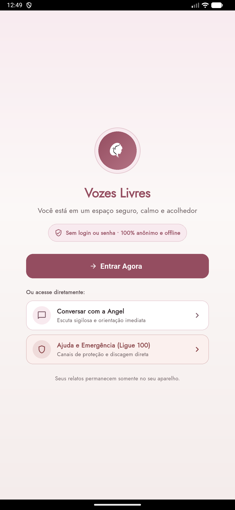
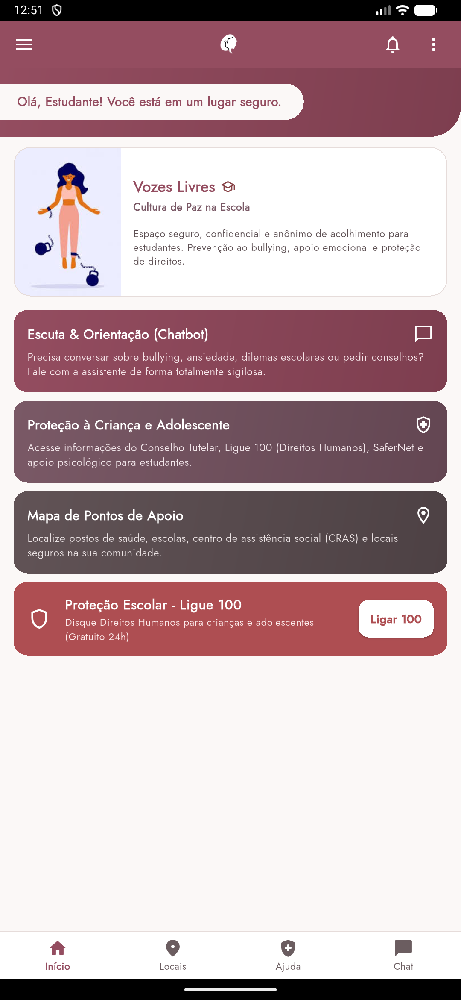
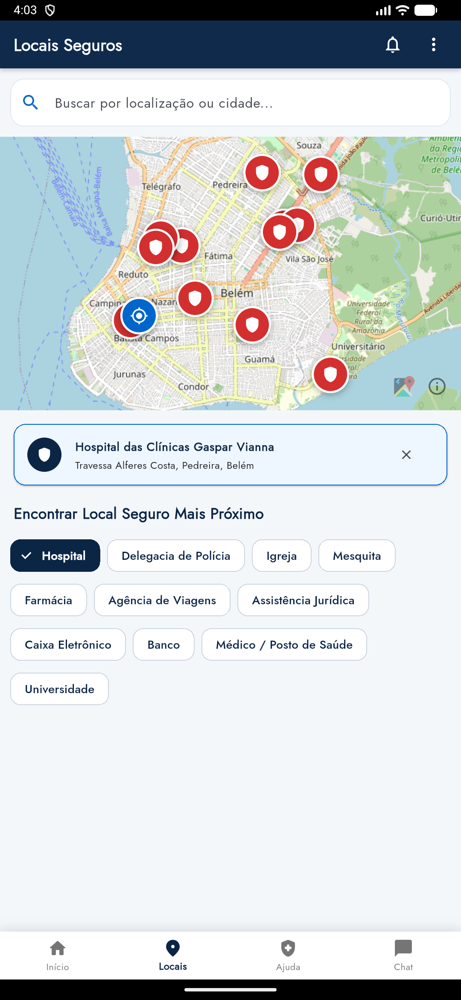
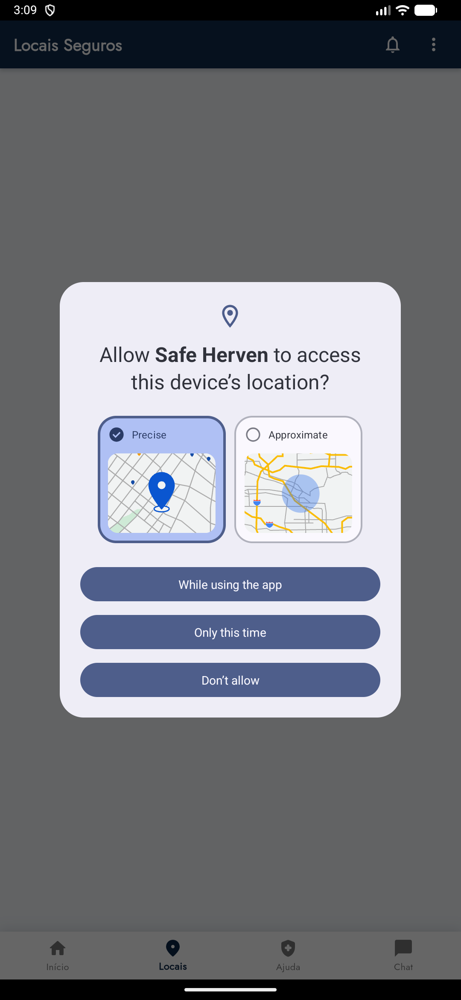
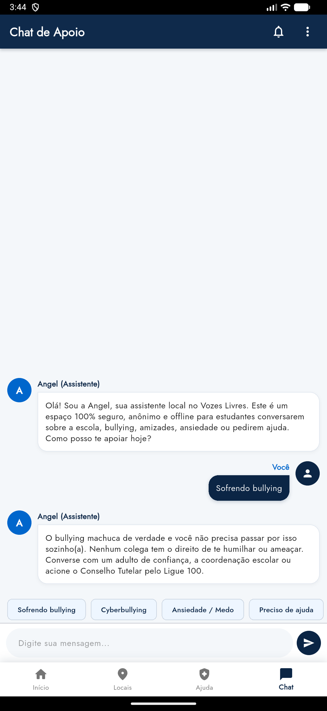
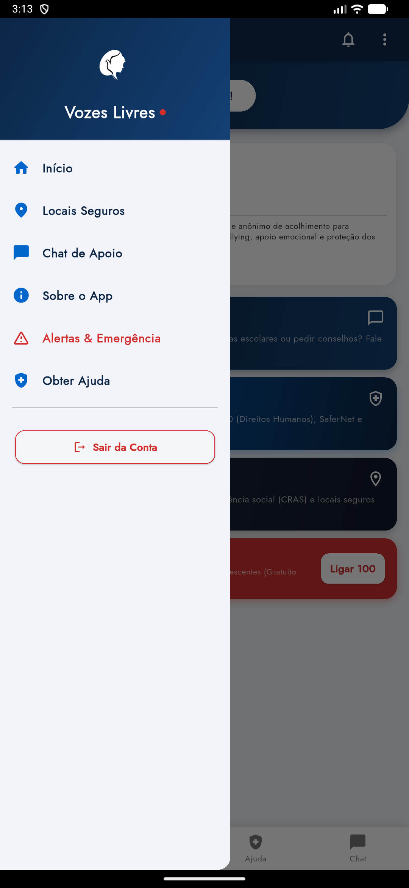
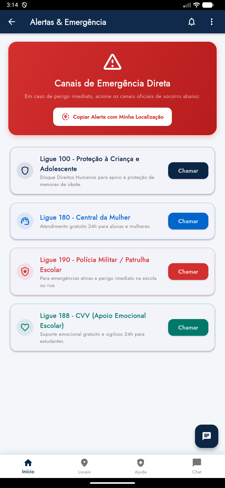
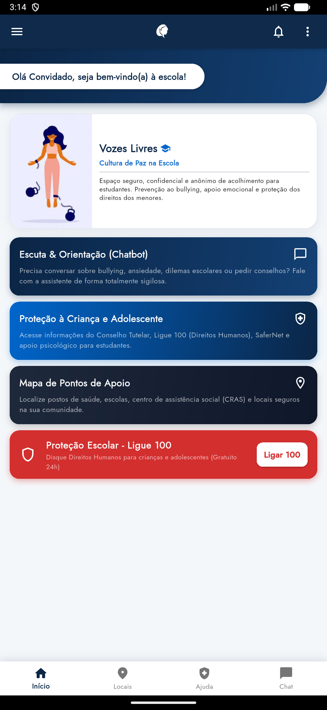

# Vozes Livres 🛡️

**Vozes Livres** é um aplicativo mobile desenvolvido para oferecer acolhimento, orientação e segurança a pessoas em situação de vulnerabilidade, vítimas de violência de gênero, abusos, agressões ou experiências traumáticas. O projeto combina **Cultura de Paz, Ciência e Tecnologia** para proporcionar um refúgio seguro e confidencial.

---

## 📌 Sumário
- [Download do Aplicativo (APK)](#-download-do-aplicativo-apk)
- [Visão Geral](#-visão-geral)
- [Principais Funcionalidades](#-principais-funcionalidades)
- [Telas e Demonstração do Aplicativo](#-telas-e-demonstração-do-aplicativo)
- [Identidade Visual](#-identidade-visual)
- [Como Executar o Projeto](#-como-executar-o-projeto)
  - [Pré-requisitos](#pré-requisitos)
  - [APIs Gratuitas e Uso Offline](#apis-gratuitas-e-uso-offline)
  - [Executando e Gerando o APK](#executando-e-gerando-o-apk)
- [Próximos Passos (Roadmap)](#-próximos-passos-roadmap)
- [Créditos e Instituição](#-créditos-e-instituição)

---

## 📥 Download do Aplicativo (APK)

Você pode baixar e instalar a versão estável mais recente (`v1.1.0`) diretamente no seu celular Android, sem precisar compilar o código nem configurar chaves de API:

- 📦 **[Baixar VozesLivres-v1.1.0.apk (Android)](https://github.com/albertomateus9/VozesLivres/releases/download/v1.1.0/VozesLivres-v1.1.0.apk)**
- 🏷️ **[Ver todas as versões em Releases](https://github.com/albertomateus9/VozesLivres/releases/latest)**

### Como instalar no Android
1. Baixe o arquivo `VozesLivres-v1.1.0.apk` pelo link acima.
2. Abra o arquivo baixado no aparelho.
3. Se o Android solicitar, habilite **"Permitir desta fonte"** / **"Fontes desconhecidas"** para concluir a instalação.
4. Pronto! Abra o app **Vozes Livres** e acesse diretamente — sem necessidade de login, senha ou cadastro.

---

## 🌟 Visão Geral

Nossa motivação é disponibilizar uma ferramenta acessível, confidencial e sem julgamentos para quem precisa desabafar, buscar orientação ou encontrar socorro rápido. Muitas pessoas que enfrentam situações de risco não sabem a quem recorrer nem onde encontrar instituições legítimas de proteção. O **Vozes Livres** conecta essas pessoas diretamente a redes de apoio, pontos de acolhimento e canais oficiais de emergência.

---

## 🚀 Principais Funcionalidades

- 💬 **Assistente Virtual de Apoio (Angel)**: Chatbot local 100% gratuito, anônimo e offline com atalhos rápidos para acolhimento, prevenção ao bullying, cyberbullying e orientação escolar.
- 🗺️ **Mapa de Locais Seguros (OpenStreetMap)**: Mapeamento aberto e gratuito com geolocalização dos pontos de apoio mais próximos (Hospitais, Delegacias, Farmácias, Postos de Saúde e Universidades), com fallback offline.
- 🏥 **Rede de Apoio & ONGs**: Lista curada disponível mesmo sem internet (Ligue 100, Conselho Tutelar, SaferNet Brasil, CVV, Ligue 180 e Mapa do Acolhimento) com discagem direta em 1 toque, e-mail e site oficial.
- 🚨 **Canais de Emergência Direta**: Acesso rápido com um toque aos números de socorro imediato (**100** - Direitos Humanos, **180** - Mulher, **190** - Polícia Militar, **192** - SAMU, **188** - CVV) e cópia rápida de coordenadas via OpenStreetMap.
- 🔒 **Entrada Direta & Privacidade Total**: Acesso imediato em um toque sem login, senha ou cadastro, com atalhos diretos para conversar com a Angel ou acionar emergência mantendo os dados apenas no dispositivo.

---

## 📱 Telas e Demonstração do Aplicativo

Abaixo estão capturas de tela da aplicação em execução no emulador Android, ilustrando a interface e o fluxo do usuário:

| 1. Entrada Direta & Acolhimento | 2. Início / Painel de Acolhimento |
| :---: | :---: |
|  |  |
| **Entrada Direta sem Login**: Acesso imediato em 1 toque, 100% anônimo e offline, com atalhos diretos para o chat e canais de emergência. | **Painel Principal**: Saudação acolhedora em paleta suave, cards rápidos para chatbot, conselho tutelar, pontos de apoio e chamada do Ligue 100. |

| 3. Mapa de Pontos de Apoio | 4. Rede de Apoio e ONGs |
| :---: | :---: |
|  |  |
| **Geolocalização**: Mapeamento interativo de delegacias, hospitais, postos de saúde e pontos de refúgio próximos. | **Diretório de Apoio**: Catálogo com busca de organizações com discagem de telefone direta em 1 toque e e-mail. |

| 5. Assistente de Escuta (Chatbot) | 6. Menu Lateral (Navegação) |
| :---: | :---: |
|  |  |
| **Escuta & Diálogo**: Chatbot seguro para acolhimento emocional, dúvidas, relatos de bullying e orientação. | **Navegação Integrada**: Menu lateral com atalhos para todas as áreas e retorno discreto à tela de entrada. |

| 7. Central de Emergência & Alertas | 8. Sobre o Projeto |
| :---: | :---: |
|  |  |
| **Emergência Rápida**: Botões de discagem imediata para Ligue 180, Polícia (190), SAMU (192) e CVV (188). | **Missão Institucional**: Contextualização do projeto, cultura de paz e créditos pedagógicos. |

---

## 🎨 Identidade Visual

A paleta do aplicativo foi desenhada com base em princípios psicofisiológicos e de neurociência ambiental (alta luminosidade e baixa saturação para conforto e redução de alerta visual):
- **Rosa Antigo Suave (`#944D60` / `#7D3E4F`)**: Transmite acolhimento, segurança e proximidade sem estímulos agressivos.
- **Malva & Taupe Neutros Suaves (`#7A5966` / `#615356`)**: Equilíbrio emocional, clareza e leitura confortável.
- **Rosa-Carmim Contido (`#AE4E52`)**: Destaque tático para emergências e alertas sem causar pânico visual.
- **Marfim Rosado & Névoa Rosa (`#FBF8F7` / `#F8EAEF`)**: Superfícies neutras suaves que reduzem fadiga visual e aumentam a sensação de calma.

---

## 🛠️ Como Executar o Projeto

### Pré-requisitos
- [Flutter SDK](https://docs.flutter.dev/get-started/install) (`channel stable`, Dart `>=3.0.0`)
- [Android Studio](https://developer.android.com/studio) ou VS Code com extensão Flutter/Dart
- Emulador Android ou dispositivo físico com depuração USB (opcional para rodar localmente)

### Clonando o Repositório
```bash
git clone https://github.com/albertomateus9/VozesLivres.git
cd VozesLivres
```

### Instalando Dependências
```bash
flutter pub get
```

---

### APIs Gratuitas e Uso Offline

O projeto **não utiliza nenhuma API com chave paga**:
- **Mapas e Geolocalização**: Utiliza **OpenStreetMap** (`flutter_map` + `latlong2`), busca de endereços e pontos próximos via **Nominatim / Overpass API** (serviços abertos e sem chave) e fallback local caso esteja offline.
- **Assistente Angel**: Roda localmente no dispositivo em português, com total privacidade e sem cobrança por tokens ou nuvem.
- **Sessão Anônima e Rede de Apoio**: Gerenciadas localmente no aplicativo para funcionamento imediato e proteção dos dados do estudante.

---

### Executando e Gerando o APK

Para iniciar o aplicativo no emulador ou dispositivo conectado:

```bash
flutter run
```

Para executar testes e gerar um novo APK de release:

```bash
flutter analyze
flutter test
flutter build apk --release
```

---

## 📌 Próximos Passos (Roadmap)

- [ ] Treinamento contínuo da IA do chatbot para ampliar o vocabulário e a empatia nas respostas.
- [ ] Fóruns de acolhimento seguro para troca de experiências entre sobreviventes.
- [ ] Expansão da base de dados de ONGs em todo o território nacional.
- [ ] Botão de pânico e compartilhamento de localização em tempo real com contatos de confiança.
- [ ] Mapeamento de profissionais de psicoterapia parceiros.

---

## 🤝 Créditos e Instituição

Desenvolvido para o projeto **Cultura de Paz, Ciência e Tecnologia - EETEPA Vilhena Alves**.

---

> *Vozes Livres — Abrace sua liberdade com segurança e proteção.* 🕊️
