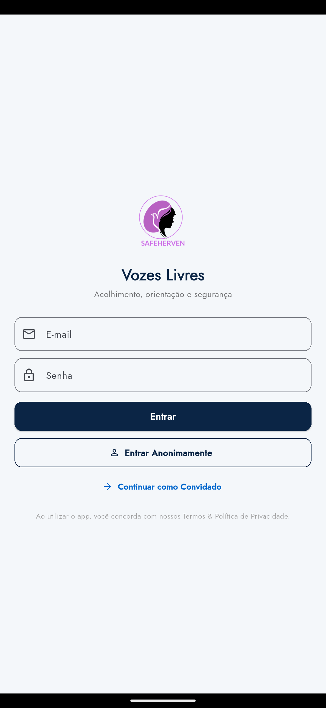
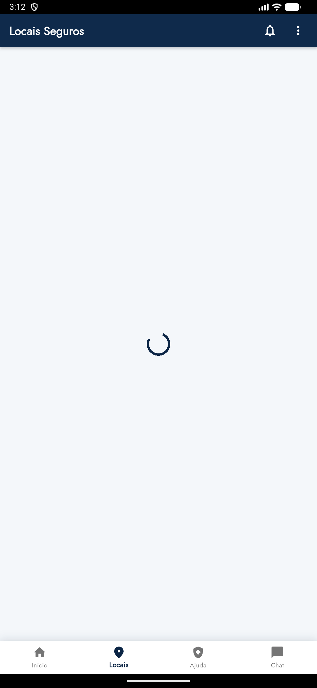
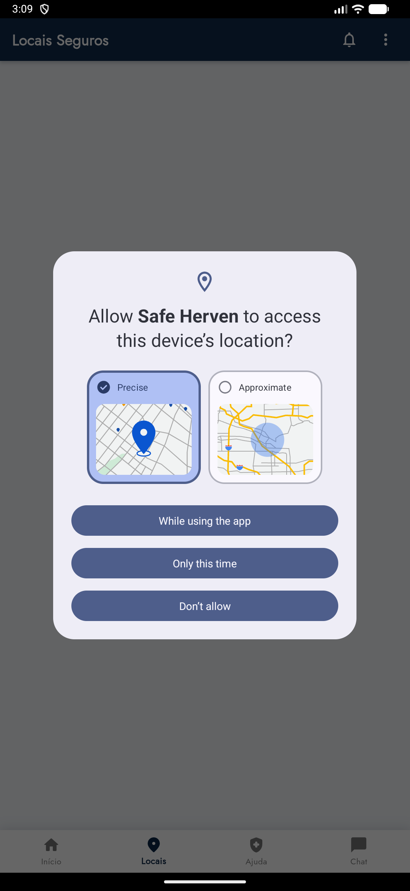
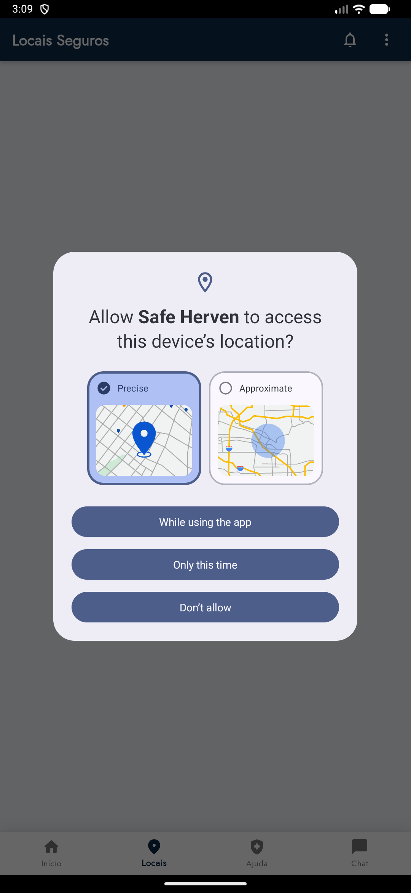
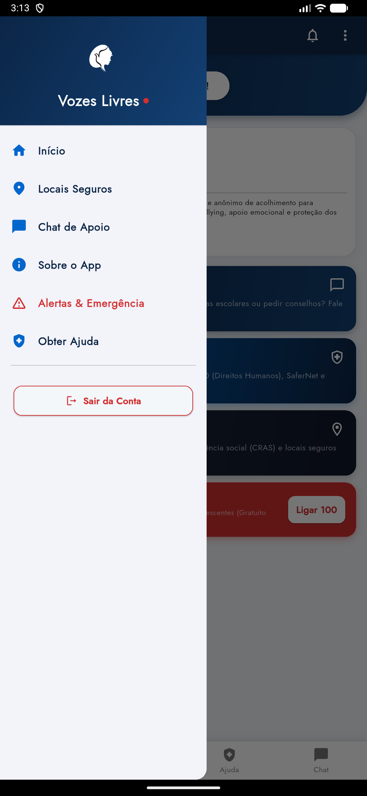
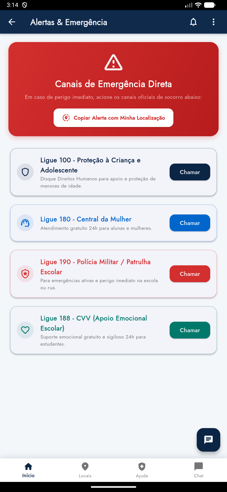
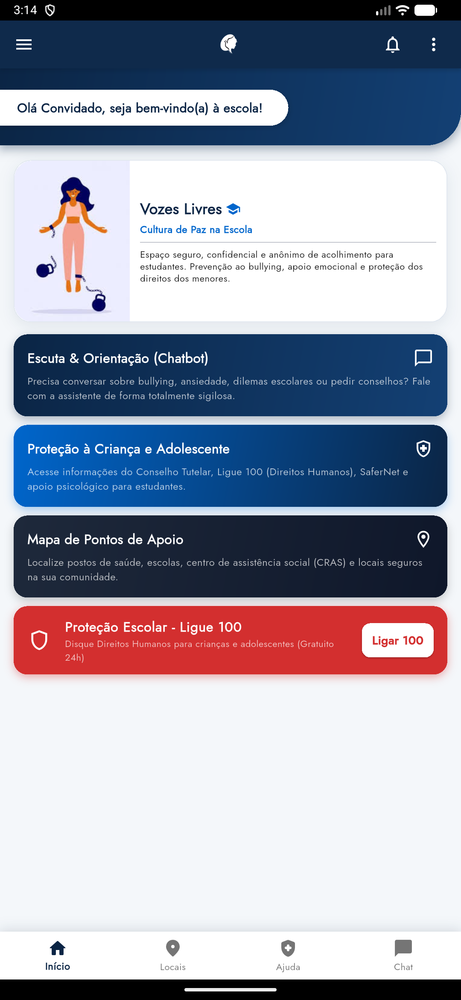

# Vozes Livres 🛡️

**Vozes Livres** é um aplicativo mobile desenvolvido para oferecer acolhimento, orientação e segurança a pessoas em situação de vulnerabilidade, vítimas de violência de gênero, abusos, agressões ou experiências traumáticas. O projeto combina **Cultura de Paz, Ciência e Tecnologia** para proporcionar um refúgio seguro e confidencial.

---

## 📌 Sumário
- [Visão Geral](#-visão-geral)
- [Principais Funcionalidades](#-principais-funcionalidades)
- [Telas e Demonstração do Aplicativo](#-telas-e-demonstração-do-aplicativo)
- [Identidade Visual](#-identidade-visual)
- [Como Executar o Projeto](#-como-executar-o-projeto)
  - [Pré-requisitos](#pré-requisitos)
  - [Configuração de Chaves e APIs](#configuração-de-chaves-e-apis)
  - [Executando a Aplicação](#executando-a-aplicação)
- [Próximos Passos (Roadmap)](#-próximos-passos-roadmap)
- [Créditos e Instituição](#-créditos-e-instituição)

---

## 🌟 Visão Geral

Nossa motivação é disponibilizar uma ferramenta acessível, confidencial e sem julgamentos para quem precisa desabafar, buscar orientação ou encontrar socorro rápido. Muitas pessoas que enfrentam situações de risco não sabem a quem recorrer nem onde encontrar instituições legítimas de proteção. O **Vozes Livres** conecta essas pessoas diretamente a redes de apoio, pontos de acolhimento e canais oficiais de emergência.

---

## 🚀 Principais Funcionalidades

- 💬 **Assistente Virtual de Apoio (Angel)**: Chatbot interativo para escuta atenta, desabafo sigiloso e suporte inicial.
- 🗺️ **Mapa de Locais Seguros**: Mapeamento com geolocalização dos pontos de apoio mais próximos (Hospitais, Delegacias, Farmácias, Abrigos e Postos de Saúde) com navegação rápida.
- 🏥 **Rede de Apoio & ONGs**: Lista curada de ONGs e serviços públicos (Ligue 180, Mapa do Acolhimento, Instituto Maria da Penha, CVV) com contatos, e-mails, endereços e links úteis.
- 🚨 **Canais de Emergência Direta**: Acesso rápido com um toque aos números de socorro imediato (**180** - Mulher, **190** - Polícia Militar, **192** - SAMU, **188** - CVV, **100** - Direitos Humanos).
- 🔒 **Modo Anônimo e Convidado**: Navegação e login simplificado sem necessidade de exposição de dados pessoais.

---

## 📱 Telas e Demonstração do Aplicativo

Abaixo estão as capturas de tela reais da aplicação em execução no emulador Android, ilustrando a interface e o fluxo do usuário:

| 1. Autenticação & Modo Anônimo | 2. Início / Painel de Acolhimento |
| :---: | :---: |
|  |  |
| **Login e Privacidade**: Opções de login tradicional, entrada anônima ou acesso como convidado sem expor identidade. | **Painel Principal**: Saudação acolhedora, cards rápidos para chatbot, conselho tutelar, pontos de apoio e chamada do Ligue 100. |

| 3. Mapa de Pontos de Apoio | 4. Rede de Apoio e ONGs |
| :---: | :---: |
|  |  |
| **Geolocalização**: Mapeamento interativo de delegacias, hospitais, postos de saúde e pontos de refúgio próximos. | **Diretório de Apoio**: Catálogo com busca de organizações com discagem de telefone direta em 1 toque e e-mail. |

| 5. Assistente de Escuta (Chatbot) | 6. Menu Lateral (Navegação) |
| :---: | :---: |
|  |  |
| **Escuta & Diálogo**: Chatbot seguro para acolhimento emocional, dúvidas, relatos de bullying e orientação. | **Navegação Integrada**: Menu lateral com atalhos para todas as áreas e encerramento seguro de sessão. |

| 7. Central de Emergência & Alertas | 8. Sobre o Projeto |
| :---: | :---: |
|  |  |
| **Emergência Rápida**: Botões de discagem imediata para Ligue 180, Polícia (190), SAMU (192) e CVV (188). | **Missão Institucional**: Contextualização do projeto, cultura de paz e créditos pedagógicos. |

---

## 🎨 Identidade Visual

O visual do aplicativo é baseado em elementos de tecnologia e cultura de paz:
- **Azul Marinho (`#0B2545`)**: Transmite confiança, estabilidade e proteção.
- **Azul Tecnologia (`#0066CC`)**: Traz clareza e acessibilidade aos recursos.
- **Vermelho Carmim (`#D32F2F`)**: Destaque tático para emergências e alertas.
- **Branco/Cinza Claro (`#F4F7FA`)**: Proporciona legibilidade e visual limpo.

---

## 🛠️ Como Executar o Projeto

### Pré-requisitos
- [Flutter SDK](https://docs.flutter.dev/get-started/install) (versão `>=2.17.0`)
- [Android Studio](https://developer.android.com/studio) ou VS Code com extensão do Flutter/Dart
- Emulador Android/iOS ou dispositivo físico com modo de depuração USB ativo

### Clonando o Repositório
```bash
git clone https://github.com/albertomateus9/VozesLivres.git
cd VozesLivres
```

### Instalando Dependências
```bash
flutter pub get
```

---

### Configuração de Chaves e APIs

#### 1. Google Maps API Key
- Obtenha uma chave no [Google Cloud Console](https://console.cloud.google.com/).
- Adicione a chave no arquivo `android/app/src/main/AndroidManifest.xml`:
  ```xml
  <meta-data
      android:name="com.google.android.geo.API_KEY"
      android:value="SUA_CHAVE_GOOGLE_MAPS_AQUI"/>
  ```
- Insira também a chave no serviço de locais em `lib/services/places_service.dart`.

#### 2. Firebase
- Crie um projeto no [Console do Firebase](https://console.firebase.google.com/).
- Baixe o arquivo `google-services.json` e adicione no diretório `android/app/`.
- Caso utilize a CLI do FlutterFire:
  ```bash
  dart pub global activate flutterfire_cli
  flutterfire configure
  ```

#### 3. Dialogflow (Chatbot)
- Configure o agente no [Console do Dialogflow](https://dialogflow.cloud.google.com/).
- Gere a chave de conta de serviço no Google Cloud em formato JSON.
- Adicione o arquivo de credenciais como `assets/credentials.json`.

---

### Executando a Aplicação

Para iniciar o aplicativo no emulador ou dispositivo conectado, execute:

```bash
flutter run
```

---

## 📌 Próximos Passos (Roadmap)

- [ ] Treinamento contínuo da IA do chatbot para ampliar o vocabulário e a empatia nas respostas.
- [ ] Fóruns de acolhimento seguro para troca de experiências entre sobreviventes.
- [ ] Expansão da base de dados de ONGs em todo o território nacional.
- [ ] Botão de pânico e compartilhamento de localização em tempo real com contatos de confiança.
- [ ] Mapeamento de profissionais de psicoterapia parceiros.

---

## 🤝 Créditos e Instituição

Desenvolvido para o projeto **Cultura de Paz, Ciência e Tecnologia - EETEPA Vilhena Alves**.

---

> *Vozes Livres — Abrace sua liberdade com segurança e proteção.* 🕊️
